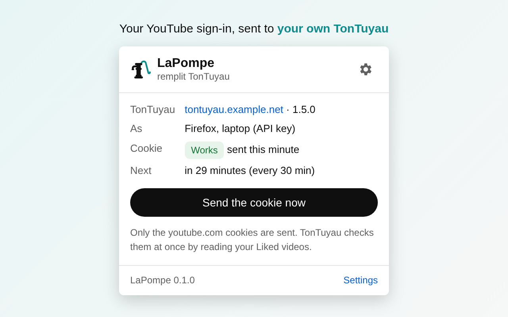
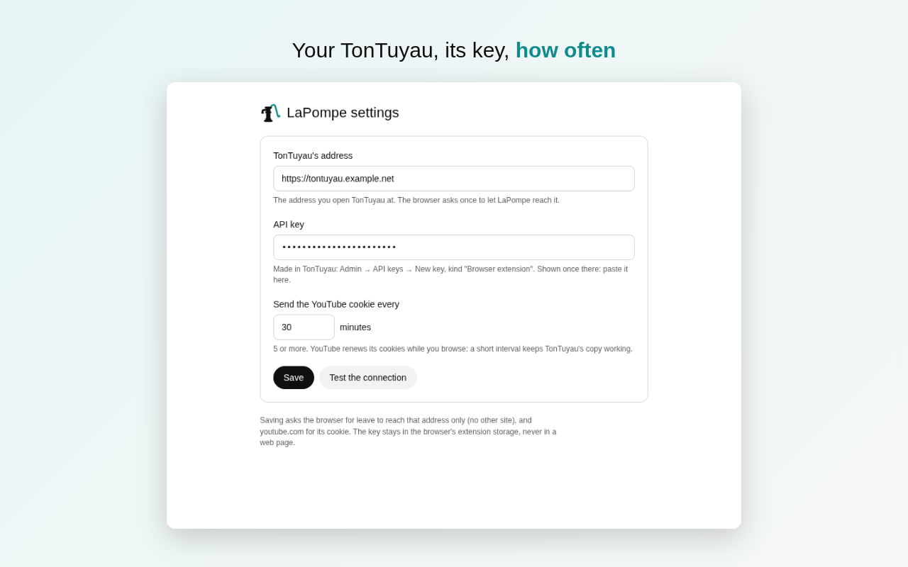

<div align="center">

<picture>
  <source media="(prefers-color-scheme: dark)" srcset="icons/lapompe-light.svg">
  
</picture>

# LaPompe

**_LaPompe remplit TonTuyau._**<br>
The pump that fills your pipe: the browser extension of [TonTuyau](https://github.com/TonTuyau/TonTuyau), your own
self-hosted YouTube.

[](https://chromewebstore.google.com/detail/lapompe/cbijokghilmbekhefojdfoipjiefmoio)
[](https://addons.mozilla.org/firefox/addon/lapompe/)
[](https://github.com/TonTuyau/LaPompe/actions/workflows/ci.yml)
[](LICENSE)

<a href="https://chromewebstore.google.com/detail/lapompe/cbijokghilmbekhefojdfoipjiefmoio"></a>
<a href="https://addons.mozilla.org/firefox/addon/lapompe/"></a>

<sub>Works in Chrome, Edge, Brave and the other Chromium browsers, and in Firefox.</sub>

</div>

<table>
  <tr>
    <td width="50%"></td>
    <td width="50%"></td>
  </tr>
  <tr>
    <td align="center"><sub>The popup: your TonTuyau, and how its YouTube sign-in is doing</sub></td>
    <td align="center"><sub>The settings: your TonTuyau, its key, how often</sub></td>
  </tr>
</table>

## What it does

### ➕ "Add to TonTuyau", right on YouTube

Next to **Subscribe**, on YouTube's own pages:

- on a video: **Add to TonTuyau** downloads it into your library;
- on a channel: **Add channel to TonTuyau** subscribes your TonTuyau to it, and its new videos come by themselves.

The button knows what your TonTuyau already has: it reads **In TonTuyau**, **Subscribed in TonTuyau** or **Waiting in
TonTuyau** instead.

### 🍪 Keeps TonTuyau signed in to YouTube

Signed in, TonTuyau reads YouTube as you do, age-restricted videos included. LaPompe sends your youtube.com cookie
to your TonTuyau every 30 minutes (you choose: 5 at least), or when you click **Send the cookie now**. TonTuyau checks
it with YouTube at once, and the popup shows the answer: **Works**, **Refused** or **Not checked**. YouTube renews its
cookies while you browse, so sending them often keeps TonTuyau's copy working.

## Setting it up

1. **Install it** from the [Chrome Web Store](https://chromewebstore.google.com/detail/lapompe/cbijokghilmbekhefojdfoipjiefmoio)
   or [Firefox Add-ons](https://addons.mozilla.org/firefox/addon/lapompe/).
2. **Make it a key** in TonTuyau: Admin → API keys → New key, of kind "Browser extension". Copy its secret: it's shown
   once.
3. **Connect it**: LaPompe's toolbar button → Settings, then TonTuyau's address and that key, and Save. The browser asks
   once to let LaPompe reach that address and youtube.com. Then **Test the connection**.
4. **Be signed in on youtube.com** in this browser. That's it.

## 🔒 Privacy

LaPompe talks to **your TonTuyau and nothing else**: no server of its own, no analytics, no ads. Your youtube.com
cookies go only to the TonTuyau address you set; the API key stays in the browser's extension storage, never in a web
page. The full policy: [PRIVACY.md](PRIVACY.md).

What it asks the browser for, and why:

| Permission               | Why                                                                   |
| ------------------------ | --------------------------------------------------------------------- |
| `cookies`, `youtube.com` | to read your YouTube cookie, and to put its button on YouTube's pages |
| your TonTuyau's address  | to reach it, and only it: asked when you save the settings            |
| `storage`                | its settings, in the extension's own storage                          |
| `alarms`                 | to send the cookie every N minutes                                    |

<details>
<summary>How it talks to TonTuyau</summary>

Every call carries the TonTuyau API key of kind "browser extension".

- **The cookie**: only the `youtube.com` cookies, as a Netscape cookie file, to `PUT /api/extension/youtube-cookie`.
  TonTuyau answers whether YouTube accepted it.
- **The button**: on each page, `GET /api/extension/videos/{id}` or `/api/extension/channels/{id}` says where that
  video or channel stands (absent, file missing, waiting, in TonTuyau); a click sends `POST` to the same address, and
  TonTuyau downloads the video, or subscribes to the channel with its default tabs, through its run queue.
- **Whether it can add**: the connection test says whether this TonTuyau adds (`canAdd`, TonTuyau 2.0 and later);
  LaPompe asks again when TonTuyau's version changes. Until then the button stays disabled, and its tooltip says why.

</details>

## Development

Node 24 and pnpm (`corepack enable`), then:

```bash
pnpm install
pnpm run build
```

`dist/chrome` and `dist/firefox` are the extension, ready to load unpacked; `dist/lapompe-<version>-<browser>.zip` are
the same, to publish.

- **Firefox**: `about:debugging` → This Firefox → Load Temporary Add-on → `dist/firefox/manifest.json`.
- **Chrome**: `chrome://extensions` → Developer mode → Load unpacked → `dist/chrome`.

`scripts/check.sh` lints, type-checks, tests and builds, as CI does on each pull request.

| Where                 | What                                                                                             |
| --------------------- | ------------------------------------------------------------------------------------------------ |
| `src/`                | the popup and the settings (Svelte), the background, the content script on YouTube               |
| `scripts/manifest.ts` | the manifest (MV3), one per browser: Chrome's background is a service worker, Firefox's a script |
| `scripts/build.ts`    | the pages (Vite), the background and content script (one file each), the icons, the zips         |
| `public/_locales`     | its words, English and French, as the browser                                                    |

<details>
<summary>Releases</summary>

Each version tag `vX.Y.Z` runs the full checks on its source, then publishes a
[GitHub Release](https://github.com/TonTuyau/LaPompe/releases) with the Chrome and Firefox zips and the source package
(`.github/workflows/release.yml`), then, once approved, submits the version to addons.mozilla.org and the Chrome Web
Store for their review ([docs/STORES.md](docs/STORES.md): how, and the credentials to set up once). What the stores ask
for is in [docs/store](docs/store/README.md); [docs/BUILD.md](docs/BUILD.md) says how to rebuild it from the source.

</details>

## License

LaPompe is free software: you can redistribute it and/or modify it under the terms of the
[GNU General Public License](LICENSE) as published by the Free Software Foundation, either version 3 of the License,
or (at your option) any later version.

LaPompe is not affiliated with, endorsed by, or sponsored by YouTube or Google.
